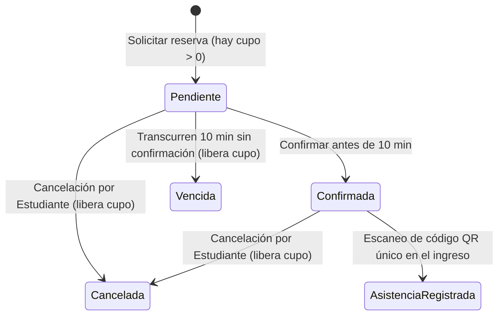

# 🎓 CampusFest — Arquitectura y Análisis Orientado a Objetos

> **Modelado de Software, Diagramas UML y Auditoría Arquitectónica para la Gestión de Eventos Universitarios**

**CampusFest** es la especificación técnica y el modelo de análisis de una plataforma diseñada para administrar el ciclo completo de eventos académicos y culturales en un campus universitario: desde el cálculo dinámico de aforos y la reserva temporal de cupos hasta el control de acceso mediante códigos QR y la generación de reportes operativos.

Este repositorio contiene el diseño arquitectónico fundamentado en el patrón **BCE (Boundary-Control-Entity / Límite-Control-Entidad)** bajo los principios de ingeniería de software de **Stephen R. Schach**, desarrollado íntegramente en diagramas UML con **Draw.io**.

---

## 🧠 Reglas de Negocio y Lógica del Dominio

### 1. Cálculo Dinámico de Disponibilidad
El cupo disponible de un evento nunca se almacena como un valor estático en las interfaces; es calculado en tiempo real por la capa de control descontando los compromisos activos del aforo total:

$$\text{Cupos Disponibles} = \text{Aforo Máximo} - (\text{Reservas Confirmadas} + \text{Reservas Pendientes Vigentes} + \text{Cupos Bloqueados})$$

* **Reservas Canceladas / Vencidas:** No descuentan cupo; se conservan únicamente con fines de trazabilidad e historial.
* **Ejemplo de Auditoría (Reto 2):** Para un evento con aforo de `120`, `83` confirmadas, `12` pendientes vigentes, `5` bloqueados y `7` canceladas, el sistema reporta exactamente **`20` cupos disponibles**.

### 2. Ciclo de Vida de una Reserva (Ventana de 10 Minutos)
Toda solicitud de reserva nace con una retención temporal de cupo y evoluciona según las acciones del estudiante o del reloj del sistema:



### 3. Control de Asistencia por QR
* Únicamente las reservas en estado **`Confirmada`** habilitan el registro de ingreso.
* Cada código QR permite **un único registro de entrada**, almacenando la marca de tiempo (`fechaHoraIngreso`).

---

## 🏛️ Arquitectura de Clases de Análisis (Patrón BCE)

El sistema separa estrictamente la interfaz de usuario, la lógica de coordinación y la persistencia de datos para mantener una arquitectura limpia y desacoplada.

### 📦 Clases de Entidad (`<<entidad>>`)
Representan la información persistente del dominio (`docs/Analisis/Clases_Entidad/`):

| Entidad | Atributos | Operaciones / Métodos | Responsabilidad Principal |
| :--- | :--- | :--- | :--- |
| **`Evento`** | `- idEvento: int`<br>`- aforoMaximo: int`<br>`- cuposBloqueados: int`<br>`- descripcion: String` | `+ actualizarTexto(): void` | Mantener la configuración de aforo, bloqueos y descripción del evento. |
| **`Reserva`** | `- idReserva: int`<br>`- estado: String`<br>`- fechaHora: DateTime` | `+ confirmar(): void`<br>`+ vencer(): void`<br>`+ cancelar(): void` | Persistir el estado actual e histórico de las reservaciones de los estudiantes. |
| **`Asistencia`** | `- idAsistencia: int`<br>`- codigoQR: String`<br>`- fechaHoraIngreso: DateTime` | `+ registrarIngreso(): void` | Almacenar la validación de entrada efectiva al evento mediante código QR. |
| **`Estudiante`** | `- idEstudiante: String`<br>`- nombre: String` | `+ consultarCupos(): void` | Identificar al usuario universitario y asociar sus reservas y asistencias (`n:m`). |

### ⚙️ Clases de Control (`<<control>>`)
Encapsulan las reglas de negocio, validaciones y cálculos:

* **`CalcularDisponibilidad`**: Recupera el aforo y los bloqueos desde `Evento` junto con las reservas activas desde `Reserva` para ejecutar la fórmula de disponibilidad sin contaminar las pantallas.
* **`GestiónReserva`**: Orquesta la creación de reservas en estado `Pendiente`, valida la ventana de 10 minutos para pasarlas a `Confirmada` o `Vencida`, y procesa cancelaciones liberando el cupo.
* **`GestiónAsistencia`**: Verifica que una reserva asociada a un código QR esté `Confirmada` antes de instanciar el registro en `Asistencia` y recopila los ingresos para los reportes.

> 💡 **Decisión Arquitectónica (Enfoque de Schach):** En el caso de uso *Gestionar Evento* (actualizar texto descriptivo), `InterfazOrganizador` se comunica directamente con la entidad `Evento` sin clase de control intermedia, evitando crear un controlador "pasamanos" para una operación *setter* elemental.

### 🖥️ Clases Límite (`<<límite>>`)
Interfaces de interacción con los actores:
* **`PantallaEventos`**: Canal de interacción con el `Estudiante` para consultas, reservas, confirmaciones, cancelaciones y lectura de QR.
* **`InterfazOrganizador`**: Panel administrativo para el `Organizador`.
* **`ReporteReservas` / `ReporteAsistencia`**: Vistas de salida especializadas para la presentación de listados consolidados.

---

## 🔄 Catálogo de Casos de Uso (`docs/Analisis/`)

Todos los casos de uso parten de una relación `<<include>>` con **Consultar eventos**. Cada módulo cuenta con **3 diagramas complementarios**:
1. `colaboracion.drawio` — Estructura estática de enlaces entre actores y objetos BCE.
2. `comunicacion.drawio` — Flujo numerado de paso de mensajes sobre los enlaces.
3. `secuencia.drawio` — Ordenamiento cronológico y líneas de vida de los objetos.

| ID | Caso de Uso | Directorio | Actor Principal | Flujo de Objetos Involucrados |
| :-: | :--- | :--- | :--- | :--- |
| **CdU 1** | Consultar cupos | `Consultar_Cupos/` | Estudiante | `PantallaEventos` → `CalcularDisponibilidad` → `Evento`, `Reserva` |
| **CdU 2** | Reservar lugar | `Reservar/` | Estudiante | `PantallaEventos` → `GestiónReserva` → `CalcularDisponibilidad` → `Evento`, `Reserva` |
| **CdU 3** | Confirmar reserva | `Confirmar_Reserva/` | Estudiante | `PantallaEventos` → `GestiónReserva` → `Reserva` |
| **CdU 4** | Cancelar reserva (Usuario) | `Cancelar_Reserva_Estudiante/` | Estudiante | `PantallaEventos` → `GestiónReserva` → `Reserva` |
| **CdU 5** | Registrar asistencia | `Registrarse_Asistencia/` | Estudiante | `PantallaEventos` → `GestiónAsistencia` → `Evento`, `Reserva`, `Asistencia` |
| **CdU 6** | Gestionar un evento | `Gestionar_Evento/` | Organizador | `InterfazOrganizador` → `Evento` *(directo sin control intermediario)* |
| **CdU 7** | Generar reporte de reservas | `Generar_Reporte_Reservas/` | Organizador | `PantallaEventos` → `GestiónReserva` → `Evento`, `Reserva` → `ReporteReservas` |
| **CdU 8** | Generar reporte de asistencia | `Generar_Reporte_Asistencia/` | Organizador | `InterfazOrganizador` → `GestiónAsistencia` → `Evento`, `Asistencia` → `ReporteAsistencia` |
| **CdU 9** | Expirar reserva por tiempo | `Cancelar_Reserva_Organizador/` | Reloj (10 min) | `GestiónReserva` → `Evento`, `Reserva` *(transición a Vencida)* |

---

## 🧩 Bitácora de Retos de Ingeniería (`Retos/`)

La carpeta [`Retos/`](./Retos) documenta la evolución incremental del diseño y la resolución de problemas de arquitectura:

* **`RETO1.drawio` — Detectives de responsabilidades:** Clasificación de estereotipos BCE y análisis del antipatrón de colocar lógica de cálculo dentro de `PantallaEventos`.
* **`RETO2.drawio` — Consultar Cupos (Colaboración):** Resolución matemática del escenario de 120 cupos totales (resultado: 20 disponibles) y trazado de pasos Actor-Sistema.
* **`RETO3.drawio` — Mensajes en desorden:** Reconstrucción de la secuencia lógica (`E → C → B → F → G → D → H → I → A`) para el cálculo de disponibilidad.
* **`RETO4.drawio` — Otro diagrama, el mismo escenario:** Contraste entre el diagrama de comunicación y el de secuencia, destacando la visibilidad del tiempo de vida de las instancias.
* **`RETO5.drawio` — ¡Nos falta una clase!:** Identificación de la clase control `GestiónReserva` y formalización de la máquina de estados (`Pendiente`, `Confirmada`, `Vencida`).
* **`RETO6.drawio` — ¿Quién coordina la operación sencilla?:** Fundamentación según Stephen R. Schach sobre cuándo omitir una clase de control innecesaria.
* **`RETO7.drawio` — Un caso de uso, dos escenarios:** Modelado del reporte de reservas justificando un único caso de uso vinculado con `<<include>>` a *Consultar eventos*.
* **`RETO8.drawio` — Integración y auditoría:** Diagrama de colaboración general, tarjeta CRC de `GestiónReserva` y corrección de dos hallazgos de auditoría:
  1. Extracción del cálculo matemático fuera de `PantallaEventos` hacia `CalcularDisponibilidad`.
  2. Incorporación de la entidad `Estudiante` y definición explícita de multiplicidades (`n:m` en reservas y `n:n` en asistencias).

---

## 📂 Estructura del Proyecto

```text
CampusFest/
├── README.md                                  # Documentación arquitectónica y técnica
├── Retos/
│   └── RETO1.drawio ... RETO8.drawio          # Solución a los 8 retos de diseño y auditoría
└── docs/
    ├── CdU/
    │   └── casos_de_uso.drawio                # Modelo general de Casos de Uso (Estudiante / Organizador)
    └── Analisis/
        ├── Colaboracion_General.drawio        # Arquitectura BCE integrada + Tarjeta CRC + Auditoría
        ├── Clases_Entidad/
        │   ├── entidad_con_estereotipos.drawio
        │   └── entidad_sin_estereotipos.drawio
        ├── Cancelar_Reserva_Estudiante/       # [colaboracion | comunicacion | secuencia].drawio
        ├── Cancelar_Reserva_Organizador/      # [colaboracion | comunicacion | secuencia].drawio
        ├── Confirmar_Reserva/                 # [colaboracion | comunicacion | secuencia].drawio
        ├── Consultar_Cupos/                   # [colaboracion | comunicacion | secuencia].drawio
        ├── Generar_Reporte_Asistencia/        # [colaboracion | comunicacion | secuencia].drawio
        ├── Generar_Reporte_Reservas/          # [colaboracion | comunicacion | secuencia].drawio
        ├── Gestionar_Evento/                  # [colaboracion | comunicacion | secuencia].drawio
        ├── Registrarse_Asistencia/            # [colaboracion | comunicacion | secuencia].drawio
        └── Reservar/                          # [colaboracion | comunicacion | secuencia].drawio
```

---

## 🛠️ Visualización y Edición de Diagramas

Todos los artefactos del repositorio están en formato estándar XML `.drawio`. Puedes inspeccionarlos o editarlos mediante:

1. **VS Code / Cursor / Antigravity:** Instalando la extensión **Draw.io Integration** (`hediet.vscode-drawio`) para abrir los archivos directamente en el editor.
2. **Navegador Web:** Cargando cualquier archivo en [app.diagrams.net](https://app.diagrams.net/).
